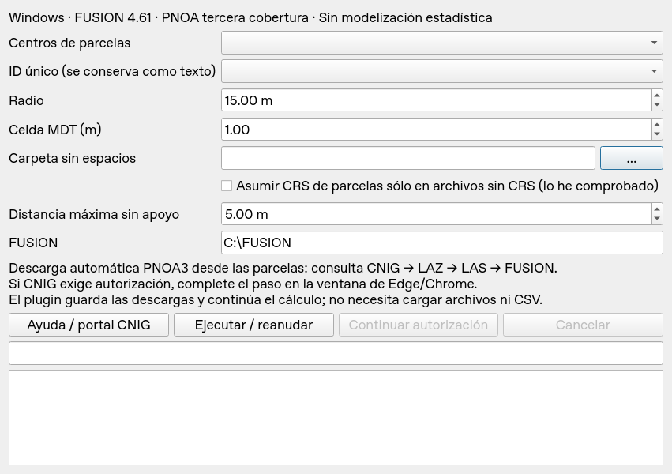

# Inventario forestal LiDAR — 0.3.2 experimental

**Entrada normal: capa de centros de parcelas, ID único, radio y carpeta de trabajo.
El plugin consulta CNIG, descarga los LAZ y continúa con LAS/FUSION. No pide CSV ni
seleccionar archivos LAZ/LAS.** La modelización estadística queda para otra fase.

## Cambio 0.3.2: Google Chrome

Se utiliza Google Chrome y ya no se selecciona Microsoft Edge automáticamente. Se
buscan las instalaciones de Chrome de equipo y de usuario; si falta, se muestra un
error para instalarlo. El registro muestra el navegador elegido.

**¿Dónde guardar?** En el flujo automático no elija carpeta ni copie la dirección a
otra ventana: use el Chrome que abre el plugin. El archivo se guarda automáticamente
en `<carpeta de trabajo>/originales/<sec>/`. Si ya lo descargó por su cuenta, guárdelo
con su nombre original en `<carpeta de trabajo>/originales/` (cree esa carpeta si no
existe) y pulse Ejecutar / reanudar; también se reconoce esa ubicación plana.
En su configuración: `Q:\LIDAR\prueba2total\originales\`. No use un nombre con `(1)`.

## Corrección 0.3.1

Admite nombres sin huso, como `PNOA-2024-PNR-523-4654-NPC01.laz`. La ausencia de
`Hxx` no declara ningún CRS: se mantienen las comprobaciones de huella oficial y
metadatos del LAZ. Las variantes con/sin huso se comparan como ediciones de la misma
tesela, sin mezclar niveles NPC ni admitir husos explícitamente incompatibles.

## Instalación / actualización

1. Instale QGIS 3.34 o posterior para Windows, preferiblemente 3.40 LTR.
2. Instale FUSION 4.61 y sus bibliotecas LAZ en `C:\FUSION`.
3. Tenga instalado Google Chrome. Se necesita para ejecutar la
   autorización oficial de CNIG, incluido reCAPTCHA. No se requieren extensiones,
   Selenium, laspy ni paquetes Python adicionales.
4. Descargue `inventario_forestal_lidar-0.3.2-experimental.zip`. En QGIS:
   **Complementos → Administrar e instalar complementos → Instalar a partir de ZIP**.
   Instale sin descomprimir y **reinicie QGIS** para retirar el código de la versión anterior.
5. La ventana debe indicar **Experimental 0.3.2**, sin campo de CSV ni selector de nubes.

FUSION no está incluido en el ZIP. Numpy, GDAL y Qt se utilizan desde QGIS.

## Uso

1. Cargue la capa de puntos simples: un centro por parcela. Seleccione un campo ID
   único y no nulo. Se procesan todas las entidades, no sólo la selección.
2. La capa debe estar en el CRS UTM de las teselas: ETRS89 EPSG:25828–25831 o REGCAN95
   EPSG:4083. Reproyecte los centros antes si hace falta. No se reproyectan las nubes.
3. Radio predeterminado: **15 m**. Carpeta absoluta sin espacios, por ejemplo
   `Q:\LIDAR\prueba2total`. Deje FUSION en `C:\FUSION` si ésa es su instalación.
4. Pulse **Ejecutar / reanudar**. El plugin consulta PNOA3 y sus huellas, deduplica
   teselas y abre una ventana independiente de Google Chrome para descargar.
5. Si CNIG pide CAPTCHA, sesión o aceptación de licencia, complete **ese trámite en
   la página oficial**. El plugin espera la descarga. Si necesita repetir el botón
   oficial después del trámite, pulse **Continuar autorización** en QGIS.
6. No tiene que guardar el archivo manualmente ni volver a seleccionarlo: el plugin
   recibe la descarga, valida su cabecera y la coloca en `originales/<sec>/`.
   Después convierte, genera el MDT, recorta/normaliza y calcula métricas.

La ventana del navegador pertenece a esta ejecución y usa un perfil temporal independiente,
no su perfil habitual. Se cierra al finalizar o cancelar. No cierre esa ventana mientras
se descargan teselas. El perfil temporal está en el TEMP local, incluso si los resultados
se guardan en una unidad de red. El plugin no lee cookies, contraseñas ni tokens.

**La autorización la decide CNIG.** Si el portal rechaza la solicitud, complete lo que
indique en su ventana y reintente. No se resuelven ni eluden CAPTCHA, no se aceptan
licencias automáticamente y no se llama directamente al endpoint binario para saltar
la preautorización. Si la autorización no termina en 15 minutos, se registra el estado
pendiente y se conservan las teselas ya descargadas para la siguiente ejecución.



## Flujo automático implementado

1. Transforma a longitud/latitud una envolvente densificada de cada círculo, con margen.
   Consulta `archivosSerie` por **POST**, con `codAgr=MOMDT` y `codSerie=LIDA3`.
2. Interpreta todas las páginas, comprueba el total y deduplica por identificador `sec`.
   Si el portal cambia el HTML o repite páginas, falla explícitamente; no lo interpreta
   como «sin cobertura». No recurre a un CSV o selección manual.
3. Elige para cada tesela el vuelo más reciente y, dentro de ese año, el mayor nivel
   NPC (03 > 02+ > 02 > 01). Registra las alternativas descartadas. Dos candidatos
   indistinguibles en año/nivel provocan error en lugar de mezclarse. El huso debe
   coincidir con los centros. La nomenclatura sólo se usa para comparar ediciones,
   **no para fabricar la huella espacial**.
4. Obtiene las geometrías oficiales con `localizarCoordsSec`, las reproyecta y comprueba
   su unión para cada círculo y dos celdas de margen. Incluye parcelas entre teselas y
   esquinas de cuatro teselas. Tolera **2 cm** en límites: las huellas verificadas del
   servicio terminan a 0,01 m de la siguiente tesela. Rechaza superficie restante sin
   cobertura superior a 0,01 m²; no exporta métricas de cobertura parcial.
5. Abre la ficha oficial de cada tesela. Activa su botón real `bDescDir`; el propio
   JavaScript CNIG ejecuta reCAPTCHA, `preAutorizarDescarga`, `initDescargaDir`, licencia
   cuando proceda y el formulario de descarga. La descarga la realiza el navegador.
6. Recoge exclusivamente el archivo de la ficha activa y comprueba su nombre y cabecera
   LAS/LAZ. Acepta la diferencia de guiones/guiones bajos entre catálogo y descarga.
   Lo copia por bloques a la unidad de salida y confirma el original de forma atómica.
7. Reutiliza originales con cabecera válida y recibo SHA-256. Un original existente sin
   recibo se adopta con validación de cabecera y nueva huella, dejando constancia de ello.
   Se reconocen también originales planos en `originales/`, con guiones o guiones bajos.
   Si el recibo existente no coincide, se detiene y conserva el archivo para revisión.
8. Convierte con `LDA2LAS` a `LAS/`, conserva el número de puntos y reutiliza conversiones
   verificadas por SHA-256. Lee CRS y metadatos de las nubes descargadas; un CRS declarado
   incompatible se rechaza. La casilla de asumir CRS sólo sirve para archivos sin CRS
   cuando usted lo haya comprobado expresamente.
9. Comprueba apoyo de retornos y suelo clase 2 antes del cálculo. Por defecto: muestras
   cada 2,5 m y apoyo a 5 m o menos, también en el margen. Ese control detecta huecos a
   su escala, no certifica ausencia de huecos menores ni calidad de clasificación.
10. Genera MDT común con **clase 2**, comprueba NoData y ejecuta `ClipData /shape:1`
    con `/dtm` y `/height`. Conserva el recorte con cotas originales y exige igual número
    de puntos en el recorte normalizado. Ejecuta `CloudMetrics /new` y exporta por ID.

## Resultados, progreso y cancelación

```text
<carpeta de trabajo>/
  originales/<sec>/<nombre>.LAZ      # original conservado; recibo SHA-256 junto a él
  LAS/<huella>.las y <huella>.json    # conversión reutilizable
  resultados/<fechaUTC>_<azar>/
    catalogo_cnig.json               # candidatos y geometrías oficiales
    plan_cnig.json                   # selección y versiones descartadas
    cobertura_cnig.json              # unión de huellas y parcela/teselas
    archivos_locales.json            # metadatos comprobados de lo descargado
    estado.json / proceso.log
    metricas.csv / metricas.gpkg
    <hash-del-ID>/
      cobertura.json / teselas.txt
      mdt.dtm / mdt.asc
      original.las / normalizada.las
      cloudmetrics.csv
      metricas.csv / metricas.gpkg
```

El ID se conserva como texto, incluidos ceros iniciales. Los directorios usan un hash
para admitir IDs no válidos como nombres Windows; `estado.json` guarda la correspondencia.
El GeoPackage contiene centros en el CRS UTM de entrada. Las columnas `cm_` conservan
como texto los valores/diagnósticos FUSION. No se aplican filtros de altura o primer retorno
sin una decisión posterior de modelización.

El registro incluye consulta, descargas, bytes recibidos, reutilización, comandos FUSION,
errores y cancelación. **Cancelar** interrumpe lecturas por bloques, cierra la sesión de
navegador creada por el plugin y detiene FUSION. Las teselas completas se conservan; una
transferencia incompleta se reinicia, sin tratar `.part` como original. Cada nueva ejecución
recalcula métricas y reutiliza las conversiones verificadas.

## Verificación y límites de la versión experimental

**Ejecutado en 0.3.2:** 48 pruebas aprobadas en Linux/QGIS 3.40.6, incluidas tres con
Chromium real contra servidor local y dos nuevas de selección de Chrome. La consulta
real de catálogo y cobertura PNR se verificó en 0.3.1. Véanse VALIDACION y FUENTES. Por
sí solas, las pruebas de selección no acreditan que CNIG autorice la sesión Chrome de
su equipo; ese paso depende del portal.

**Pendiente:** autorización reCAPTCHA y descarga LAZ real con Edge/Chrome en Windows,
y ejecución FUSION real de extremo a extremo. El ensayo completo automatizado sustituye
CNIG/FUSION por fixtures; no se presenta como validación real de esos cálculos o descargas.

El adaptador utiliza el protocolo web que sirve el portal, **no una API pública con
contrato de estabilidad**. Si CNIG cambia sus formularios o rechaza la autorización,
se registra el bloqueo y se conservan los originales; no se promete que la autorización
siempre sea concedida ni se cambia el flujo por pasos manuales de carga de archivos.

## Desarrollo

```sh
python -m unittest discover -s tests -v
QT_QPA_PLATFORM=offscreen /usr/bin/python3 -m unittest discover -s tests -v
LIDAR_BROWSER_TEST_EXE=/ruta/chromium QT_QPA_PLATFORM=offscreen /usr/bin/python3 -m unittest discover -s tests -v
python tools/build.py
```

Con Python sin QGIS se ejecutan 35 pruebas y se omiten 13 de integración; con QGIS,
45 y 3 omitidas; con navegador configurado, las 48. Los tests del navegador son sólo
locales, no intentan superar un CAPTCHA oficial. El ZIP es determinista e incluye SHA-256.
La CI ejecuta las pruebas portables y publica la prerelease con el ZIP correspondiente.

Consulta de diagnóstico de sólo lectura, sin descarga ni FUSION:

```sh
python tools/cnig_probe.py --x 629000 --y 4780000 --epsg 25829 --output carpeta_diagnostico
```

`tools/windows_smoke.py` sigue siendo un ensayo FUSION independiente con LAS sintéticos,
**no una prueba de descarga CNIG**. Para verificar el flujo real, ejecute la interfaz
con parcelas de cobertura PNOA3 conocida y siga el protocolo de VALIDACION.

Licencia GPL-3.0 del repositorio. Datos y huellas CNIG: conserve la atribución según su
licencia, año de vuelo y nivel NPC. FUSION y el navegador no se redistribuyen.
