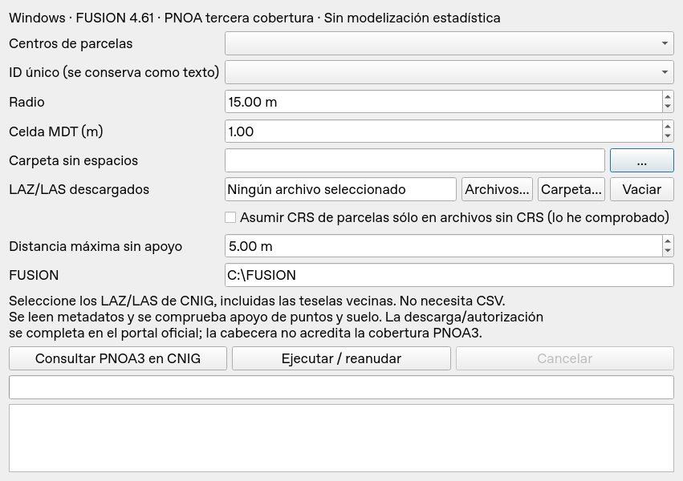

# Inventario forestal LiDAR — 0.2.0 experimental

Plugin QGIS para Windows con FUSION 4.61 en `C:\FUSION`.
**Ya no necesita preparar ni seleccionar un índice CSV.**

## Actualizar desde 0.1.0

1. Descargue `inventario_forestal_lidar-0.2.0-experimental.zip` desde la nueva release.
2. En QGIS cierre el complemento y abra **Complementos → Administrar e instalar
   complementos → Instalar a partir de ZIP**. Instale el ZIP sin descomprimir.
3. Si QGIS mantiene cargada la versión antigua, reinicie QGIS. La ventana debe mostrar
   **Experimental 0.2.0** y el campo **LAZ/LAS descargados**, sin «Índice oficial CNIG».

Requisitos: QGIS 3.34 o posterior para Windows, FUSION 4.61 y sus bibliotecas LAZ.
Numpy, GDAL y Qt se usan desde la instalación QGIS; no se requiere instalar laspy.

## Uso sin índice

1. Descargue las teselas PNOA tercera cobertura desde el portal oficial CNIG. El botón
   **Consultar PNOA3 en CNIG** abre el catálogo. Complete allí la autorización o la cesta
   oficial si se requiere. Seleccione un solo año/vuelo/nivel NPC por zona.
2. Seleccione la capa de centros, su campo ID único, el radio (15 m por defecto) y
   una carpeta de trabajo sin espacios, por ejemplo `Q:\LIDAR\prueba2total`.
3. En **LAZ/LAS descargados**, pulse **Archivos…** y seleccione uno o varios originales,
   o **Carpeta…** para buscar archivos recursivamente. Puede añadir archivos en varias
   selecciones; **Vaciar** limpia la lista. El tooltip muestra las rutas seleccionadas.
   Incluya las teselas vecinas para parcelas en límites y esquinas.
4. El plugin lee automáticamente extensión de puntos, cantidad, formato, escalas y CRS
   de los metadatos LAS/LAZ (GeoTIFF o WKT, incluidos EVLR). No usa el nombre del archivo
   para inventar el huso o una huella oficial.
5. Los centros deben usar el mismo CRS UTM que las nubes: ETRS89 EPSG:25828–25831 o
   REGCAN95 EPSG:4083. Reproyecte la capa antes si hace falta. No se reproyectan las nubes.
6. Sólo si el archivo carece de CRS y usted ha comprobado cuál es, active **Asumir CRS
   de parcelas sólo en archivos sin CRS**. La decisión queda registrada. Esa casilla
   nunca permite ignorar un CRS declarado incompatible o contradictorio.
7. Pulse **Ejecutar / reanudar**. Se conservan los originales donde estaban, incluso
   si sus carpetas o nombres contienen espacios. Los derivados se guardan en la carpeta
   de trabajo sin espacios. Se procesan todas las entidades de la capa, no sólo la selección.

El ID debe ser único y no nulo. Se conserva como texto, incluidos los ceros iniciales.



## Comprobaciones y cobertura

- Deduplicación por ruta y SHA-256 de contenido: dos copias idénticas se leen una vez.
  Un LAZ y un LAS del mismo vuelo no son idénticos en bytes: seleccione una sola
  representación. Los archivos distintos con envolventes solapadas cerca de la parcela
  se rechazan para no sumar vuelos o niveles NPC silenciosamente.
- Se seleccionan por sus metadatos todos los archivos próximos al círculo, con margen
  para terreno y comprobación. Si no hay archivos cercanos, se indica la parcela afectada.
- Después de convertir, se comprueba **apoyo de retornos reales y de suelo clase 2** en
  muestras del círculo ampliado en dos celdas MDT. La separación entre muestras es la
  mitad de **Distancia máxima sin apoyo** (5 m por defecto, muestras cada 2,5 m).
  Cada muestra debe tener retornos y suelo a esa distancia o menos.
- Si falta una tesela o hay una zona sin apoyo suficiente, se detiene antes de las
  métricas, indicando ID, coordenadas y número de muestras sin apoyo. Añada los archivos
  vecinos y vuelva a ejecutar. Si la causa es baja densidad de suelo, revise los datos;
  aumentar la distancia relaja el control y puede ocultar huecos.
- El MDT se calcula con puntos clase 2 de los LAS vecinos. Se comprueba además que no
  haya NoData en el círculo y su margen de interpolación.
- `ClipData /shape:1 /dtm:... /height` normaliza el círculo. Se conserva otro recorte
  con cotas originales y se exige el mismo número de puntos antes y después.
- `CloudMetrics /new` calcula métricas de todos los retornos normalizados, sin filtros
  adicionales de altura, clase o primer retorno.

**Límite de la comprobación:** la envolvente de puntos no equivale a la huella de
entrega oficial. El apoyo muestreado detecta huecos a la escala configurada, pero no
prueba ausencia de huecos menores ni completitud de adquisición. El manifiesto identifica
esa comprobación como `sampled_point_and_class2_support`, nunca como huella oficial
verificada. Una cabecera LAS tampoco acredita por sí sola pertenencia a PNOA3, año,
nivel NPC o compatibilidad de datum vertical: compruébelos al descargar desde CNIG.

## Conversión, caché, resultados y cancelación

La conversión LAZ/LAS usa `LDA2LAS`. Los originales sólo se leen. Cada LAS derivado se
valida por número de puntos y se asocia a un recibo SHA-256; la siguiente ejecución lo
reutiliza si original y derivado coinciden. Se comprueba que el original no cambió entre
la lectura de metadatos y la conversión. Cada ejecución crea su propia carpeta.

```text
<carpeta de trabajo>/
  LAS/<huella>.las y <huella>.json
  resultados/<fechaUTC>_<azar>/
    archivos_locales.json      # rutas, envolventes de puntos, CRS, supuestos y hashes
    teselas.json               # candidatos seleccionados y clase de extensión
    estado.json / proceso.log
    metricas.csv / metricas.gpkg
    <hash-del-ID>/
      cobertura.json           # método de apoyo muestreado y parámetros
      teselas.txt
      mdt.dtm / mdt.asc
      original.las / normalizada.las
      cloudmetrics.csv
      metricas.csv / metricas.gpkg
```

CSV y GeoPackage por ID y conjuntos. El GeoPackage contiene centros en el CRS UTM de
entrada. Los directorios usan un hash para admitir caracteres no válidos en Windows;
la correspondencia se guarda en `estado.json`. Las columnas `cm_` conservan los valores
originales FUSION como texto, incluidos diagnósticos. La modelización estadística sigue
reservada para una segunda fase.

**Cancelar** detiene el proceso externo activo y registra el estado. La cancelación de
lectura de nubes y huellas SHA-256 se comprueba por bloques. Al repetir se reutilizan
conversiones verificadas, no resultados de métricas anteriores.

## Estado de CNIG y pruebas

Nueva consulta HTTP al catálogo en el entorno de desarrollo: **503**. No se ha podido
verificar un servicio público de búsqueda espacial/descarga programática. Esta versión
resuelve el bloqueo del CSV mediante archivos locales; **la descarga sigue haciéndose
por el portal oficial**, con su autorización cuando sea necesaria. No pide credenciales,
extrae cookies ni elude controles del servicio.

El motor conserva compatibilidad programática con el índice de 0.1.0 para scripts
existentes, pero la interfaz ya no lo pide. No necesita conocer `sec` ni rellenar límites.

Pruebas y pendientes detallados en [docs/VALIDACION.md](docs/VALIDACION.md).
Fuentes y parámetros FUSION en [docs/FUENTES.md](docs/FUENTES.md).

```sh
python -m unittest discover -s tests -v
QT_QPA_PLATFORM=offscreen /usr/bin/python3 -m unittest discover -s tests -v
python tools/build.py
```

El primer comando omite las pruebas QGIS si ese intérprete no lo incluye. Para comprobar
FUSION realmente en Windows, abra el entorno Python QGIS/OSGeo4W y ejecute:

```powershell
python tools/windows_smoke.py C:/lidar_smoke_nuevo
```

Ese test genera cuatro LAS con CRS y comprueba un círculo sobre su esquina, alturas 0 y
10 m y exportación, usando directamente la entrada local **sin CSV**. Requiere carpeta
vacía y FUSION real. **No se ha ejecutado en Windows durante esta entrega.**

Licencia GPL-3.0 del repositorio. FUSION no se redistribuye. Respete la atribución y
licencia CNIG de los datos de entrada.
